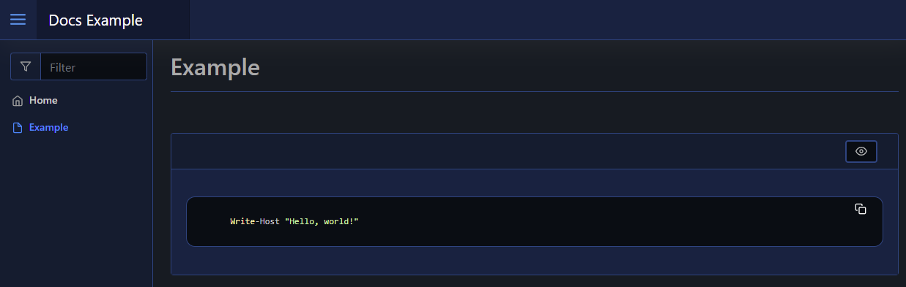

# Code Block

| Support |     |
| ------- | --- |
| Events  | Yes |

The Code Block element will render pre-formatted text as `<pre>value</pre>`. To create a Code Block element you use [`New-PodeWebCodeBlock`](../../../Functions/Elements/New-PodeWebCodeBlock), and you can specify the highlighting language via `-Language` - the default is plain text.

```powershell
New-PodeWebCard -Content @(
    New-PodeWebCodeBlock -Value 'Write-Host "Hello, world!"' -Language PowerShell
)
```

Which looks like below:



## Indentation

The Code Block element will remove any indentation, based on the whitespace of the first line provided - this is due to the element being a free-form `<pre>` element, which preserves all whitespace.

If you would like the indentation you supply to be preserved, supply `-PreserveIndentation` to [`New-PodeWebCodeBlock`](../../../Functions/Elements/New-PodeWebCodeBlock).

For example, with `-PreserveIndentation` the following:

```powershell
New-PodeWebCodeBlock -Language PowerShell -PreserveIndentation -Value "
    function Write-SomeStuff
    {
        param(
            [Parameter()]
            [string]
            `$Message
        )

        Write-Host `$Message
    }

    Write-SomeStuff -Message 'Hello, there'
"
```

would be rendered as:

```powershell

    function Write-SomeStuff
    {
        param(
            [Parameter()]
            [string]
            $Message
        )

        Write-Host $Message
    }

    Write-SomeStuff -Message 'Hello, there'

```

while normally it would be rendered as:

```powershell
function Write-SomeStuff
{
    param(
        [Parameter()]
        [string]
        $Message
    )

    Write-Host $Message
}

Write-SomeStuff -Message 'Hello, there'
```
