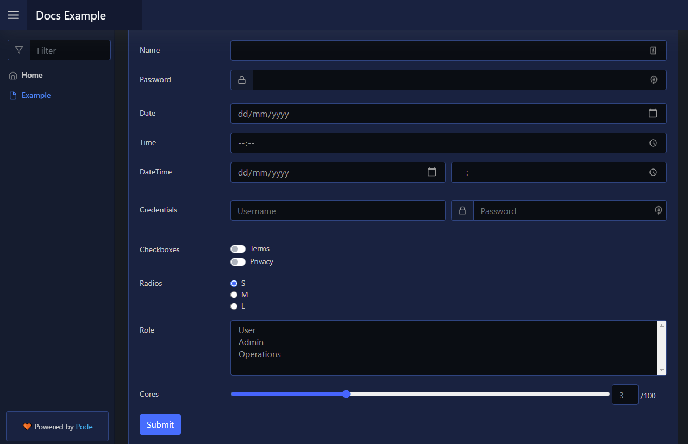

# Form

| Support |     |
| ------- | --- |
| Events  | No  |

A form contains other elements, supplied via `-Content`, and it automatically wraps them in a `<form>` and adds a submit button to the bottom. When clicked, the form is serialised and sent to the `-ScriptBlock`. To add a form to your page use [`New-PodeWebForm`](../../../Functions/Elements/New-PodeWebForm) along with other form elements:

```powershell
New-PodeWebCard -Content @(
    New-PodeWebForm -Name 'Example' -ScriptBlock {
        $WebEvent.Data | Out-Default
    } -Content @(
        New-PodeWebTextbox -Name 'Name' -AutoComplete {
            return @('billy', 'bobby', 'alice', 'john', 'sarah', 'matt', 'zack', 'henry')
        }
        New-PodeWebTextbox -Name 'Password' -Type Password -PrependIcon Lock
        New-PodeWebTextbox -Name 'Date' -Type Date
        New-PodeWebTextbox -Name 'Time' -Type Time
        New-PodeWebDateTime -Name 'DateTime'
        New-PodeWebCredential -Name 'Credentials'
        New-PodeWebCheckbox -Name 'Checkboxes' -Options @(
            'Terms', 'Privacy' | ConvertTo-PodeWebOption
        ) -AsSwitch
        New-PodeWebRadio -Name 'Radios' -Options @(
            'S', 'M', 'L' | ConvertTo-PodeWebOption
        )
        New-PodeWebSelect -Name 'Role' -Multiple -Options @(
            'User', 'Admin', 'Operations' | ConvertTo-PodeWebOption
        )
        New-PodeWebRange -Name 'Cores' -Value 30 -ShowValue
    )
)
```

Which looks like below:



!!! note
    If you have multiple forms on one page, make sure the Name/IDs are unique, including the Name/IDs of all form input elements as well.

You can pass values to the scriptblock by using the `-ArgumentList` parameter. This accepts an array of values/objects, and they are supplied as parameters to the scriptblock:

```powershell
New-PodeWebForm -Name 'Example' -ArgumentList 'Value1', 2, $false -ScriptBlock {
    param($value1, $value2, $value3)

    # $value1 = 'Value1'
    # $value2 = 2
    # $value3 = $false
} -Content @()
```

## Elements

The available form elements in Pode.Web are:

* [Checkbox](../Checkbox)
* [Credentials](../Credentials)
* [DateTime](../DateTime)
* [FileUpload](../FileUpload)
* [Hidden](../Hidden)
* [MinMax](../DateTime)
* [Range](../Range)
* [Radio](../Radio)
* [Range](../Range)
* [Select](../Select)
* [Textbox](../Textbox)

### Label State

You can control a Form Element's label appearance using `-LabelState`, with the default value being `Automatic` - the label will appear if the element is detected to be within a Form.

You can also force the label to `Show` or `Hide`, allowing to to force a label to be shown or hidden.

```powershell
New-PodeWebTextbox -Name 'Password' -Type Password -LabelState Hide -Required
```

### Label Width

You can optionally specify the width used by the label, by using the `-LabelWidth` parameter. Form elements are rendered using a grid, which is split up into 12 segments, and the `-LabelWidth` parameter lets you specify a value between 1 and 12 - the default value is 2. A value of 12 means the label takes up the full width of the grid, where as 6 would be half the width.

You can also supply the value as a percentage as well; 50% being 6 segments, etc.

```powershell
New-PodeWebTextbox -Name 'Date' -Type Date -LabelWidth 1
```

## Method/Action

The default method for forms is `Post`, and the action is the internal route created for the form.

You can change these values by using the `-Method` and `-Action` parameters. The method can only be `Get` or `Post`, and the action must be a valid URL.

## Buttons

You can customise which buttons are visible at the bottom of the Form by using the `-ButtonType` parameter on [`New-PodeWebForm`](../../../Functions/Elements/New-PodeWebForm).

By default, this parameter has the value "Submit", but you can supply one or more of the following values to change this:

* None
* Submit
* Reset

Following are some examples:

```powershell
# default submit button:
New-PodeWebForm -Name 'Example' -Content @() -ScriptBlock {}

# if you want a Form with a Submit and Reset button:
New-PodeWebForm -Name 'Example' -ButtonType Submit, Reset -Content @() -ScriptBlock {}

# if you want a Form with just a Reset button:
New-PodeWebForm -Name 'Example' -ButtonType Submit, Reset -Content @() -ScriptBlock {}

# if you want a Form with no buttons:
New-PodeWebForm -Name 'Example' -ButtonType None -Content @() -ScriptBlock {}
```

### Inline

This only really works for Forms with a single element, and using `-LabelState Hide`, but you can supply `-Inline` and the buttons and element will be rendered inline with one another - rather than having the buttons on a new line.
